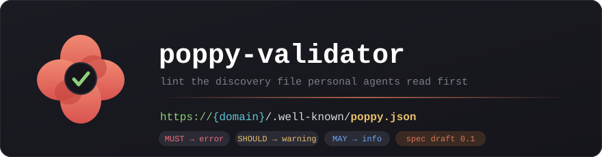
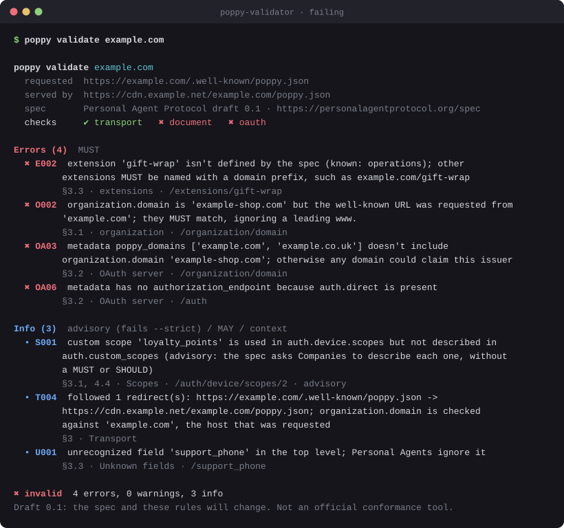
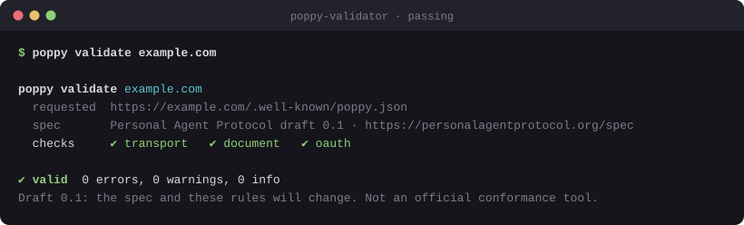
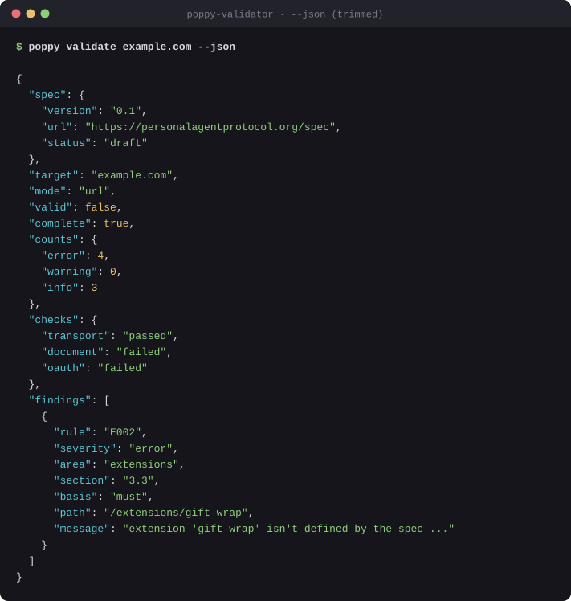
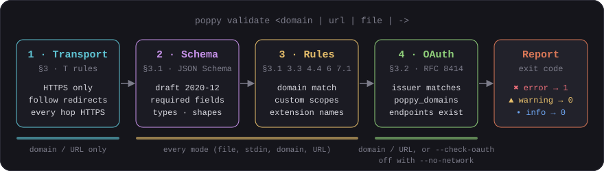

<div align="center">



# 🌺 poppy-validator

**A command-line linter for `poppy.json`, the discovery file that tells personal agents how to work with your company.**

*64 rules · 4 check stages · every rule tied to a section of the Personal Agent Protocol draft 0.1*


[Peek](#-a-peek) · [What is Poppy?](#-what-is-poppy) · [Quick start](#-quick-start) · [Usage](#-usage) · [How it works](#-how-it-works) · [Rules](#-the-rules) · [Spec decisions](#-spec-decisions) · [Contribute](#-contributing)

</div>

> [!WARNING]
> **Draft 0.1: the rules will change.** The [Personal Agent Protocol spec](https://personalagentprotocol.org/spec) says so itself: "Any part of it can change before a stable version, including in ways that aren't backward compatible." This validator tracks draft 0.1 only. It's an independent project, not an official conformance tool, and passing it doesn't mean a Personal Agent will accept your document.

---

## 👀 A peek



<table>
<tr>
<td width="50%"><br><b>Clean run</b>: the spec's own example.com document passes all three stages.</td>
<td width="50%"><br><b><code>--json</code></b>: the same findings, for CI and scripts.</td>
</tr>
</table>

<sub>These are real `poppy` output rendered to SVG by <a href="scripts/render_readme_svgs.py"><code>scripts/render_readme_svgs.py</code></a>. The example.com responses come from canned copies of the spec's examples, not the network.</sub>

---

## 🤔 What is Poppy?

**Personal Agent Protocol** (Poppy for short) defines how a Personal Agent, acting for one person, works with a company on that person's behalf: signing in, browsing, calling APIs, and talking to the company's own agent. It all starts with **one JSON file at `https://{domain}/.well-known/poppy.json`**, which tells the agent where everything is.

| | Who reads it | What it says |
|---|---|---|
| **`robots.txt`** | Crawlers | *Which pages you may fetch* |
| **`/.well-known/oauth-authorization-server`** | OAuth clients | *Where the token and authorization endpoints are* |
| **`/.well-known/poppy.json`** ✨ | Personal Agents | *How to start sessions and sign in, which APIs you offer, and how to reach your Company Agent* |

A mistake in that file breaks every agent at once, and some mistakes are security problems. For example, the spec requires your OAuth server to list your domain in `poppy_domains`, "otherwise any domain could claim another Company's issuer and receive its tokens." **poppy-validator catches these before agents do.**

---

## 🚀 Quick start

**1. Check your Python.** You need 3.11 or newer.

```bash
python3 --version
```

**2. Install from GitHub.** The package isn't on PyPI yet, so install it straight from this repo:

```bash
uv tool install git+https://github.com/tusharck/poppy-validator
# or: pipx install git+https://github.com/tusharck/poppy-validator
```

From a local checkout, run `uv tool install .` in the repo root instead.

**3. See what a valid file looks like.** This prints the spec's own example:

```bash
poppy example > poppy.json
```

**4. Validate.** Point it at a file, or at your live domain:

```bash
poppy validate poppy.json --domain example.com
poppy validate example.com
```

> [!TIP]
> Validate the file locally with `--domain` while you write it, then validate the live domain once it's deployed. Only the live check covers HTTPS, redirects, and your OAuth server.

---

## 🧭 Usage

```text
poppy validate TARGET [--domain D] [--no-network] [--check-oauth]
                      [--json] [--strict] [-q] [--color auto|always|never] [--timeout S]
poppy example [--oauth-metadata]
poppy rules [--json]
```

`TARGET` can be any of these:

| Target | Example | What runs |
|---|---|---|
| **A domain** | `poppy validate example.com` | Fetches `https://example.com/.well-known/poppy.json`, then transport, schema, rules, and the OAuth cross-check |
| **A URL** | `poppy validate https://example.com/.well-known/poppy.json` | The same. Any other URL (a staging copy, say) is checked as a document only |
| **A file** | `poppy validate poppy.json --domain example.com` | Schema and rules. Add `--check-oauth` for the live OAuth cross-check |
| **stdin** | `cat poppy.json \| poppy validate - --domain example.com` | The same as a file |

### Flags

| Flag | What it does |
|---|---|
| `--domain D` | The domain the document is published for. Turns on the `organization.domain` match (`O002`) for files and non-well-known URLs |
| `--no-network` | For a domain or URL: **fetch only `poppy.json` itself** and skip the live OAuth server cross-check |
| `--check-oauth` | For a file: also fetch `auth.issuer`'s RFC 8414 metadata and cross-check it |
| `--json` | Print a machine-readable report |
| `--strict` | Also fail on warnings and on info findings whose basis is `advisory` |
| `-q`, `--quiet` | Hide context info in human output (advisory info stays) |
| `--color` | `auto` (default; honours `NO_COLOR`), `always`, or `never` |
| `--timeout S` | Network timeout in seconds (default 10) |

### Exit codes

| Code | Meaning |
|---|---|
| `0` | No errors. Warnings and info (advisory or context) may be present |
| `1` | At least one error, or with `--strict`, at least one warning or info finding with basis `advisory` |
| `2` | Usage error: the target isn't a file, a domain, or a URL |

### In CI

```bash
poppy validate example.com --json > poppy-report.json   # exits 1 on any MUST violation
jq -r '.findings[] | select(.severity != "info") | "\(.rule) \(.path) \(.message)"' poppy-report.json
```

Each finding in the JSON report has `rule`, `severity` (`error`, `warning`, `info`), `area`, `section` (in the spec), `basis` (see [the rules](#-the-rules)), `path` (a JSON Pointer into your document), and `message`. The report also has `valid`, `complete`, `counts`, and a `checks` object with `passed`, `failed`, `skipped`, or `incomplete` for `transport`, `document`, and `oauth`. `complete` is `false` when a validator safeguard (`T007`) stopped a check early: no errors were found, but not everything was checked.

### Other commands

```bash
poppy example                    # the spec's example.com poppy.json (section 3)
poppy example --oauth-metadata   # the spec's example OAuth server metadata (section 3.2)
poppy rules                      # every rule, grouped, with its spec section
poppy rules --json
```

---

## 🔧 How it works



1. **Transport** (§3). Requests `https://{domain}/.well-known/poppy.json`. Redirects are followed one hop at a time so every hop can be checked: **a redirect to plain HTTP stops the run**, just as Personal Agents must stop. The spec sets no hop limit. A loop is an error (`T003`), because it never reaches a document; a chain longer than the validator's 20-hop safeguard is reported as incomplete (`T007`), not as a violation.
2. **Schema** (§3.1). A hand-written [JSON Schema (draft 2020-12)](src/poppy_validator/data/poppy-0.1.schema.json) checks required fields, types, and shapes. It allows unknown fields, because the spec says implementations MUST ignore them.
3. **Rules** (§3.1, 3.3, 4.4, 6, 7.1). Python checks for the things a schema can't express: the domain match, undescribed custom scopes, extension names, version handling, and unknown fields.
4. **OAuth cross-check** (§3.2). Fetches the issuer's [RFC 8414](https://www.rfc-editor.org/rfc/rfc8414) metadata and checks that `issuer` matches exactly, that `poppy_domains` lists your domain, and that the endpoints your sign-in types need exist.

### Severity follows RFC 2119

**MUST/SHOULD violations follow RFC 2119 keywords; everything else is advisory best-practice, promoted only under `--strict`.**

| Level | When | Exit code |
|---|---|---|
| 🔴 **error** | A MUST or MUST NOT is broken, or a required field is missing or malformed | `1` |
| 🟡 **warning** | A SHOULD is broken, or a validator safeguard stopped a check early (`T007`) | `0` (`1` with `--strict`) |
| 🔵 **info**, advisory basis | Best practice the spec supports in prose, with no uppercase MUST or SHOULD: undescribed custom scopes, HTTPS on fields the spec doesn't mark HTTPS, blank names | `0` (`1` with `--strict`) |
| 🔵 **info**, any other basis | `context`: MAY misuse and context (a redirect was followed, a check was skipped). `must`: unknown fields (`U001`), which the spec says MUST be ignored | `0`, even with `--strict` |

Draft 0.1 has no uppercase SHOULD that a Company's `poppy.json` can break: its SHOULDs are about what Personal Agents do. So today every document finding is either an error or info, and the only warning is `T007`.

There are **three severities and no others**: `error`, `warning`, and `info`. **`--strict` fails an info finding only when its `basis` is `advisory`.** Info with basis `context` or `must` never fails, even with `--strict`. Today the info rules use exactly those three bases:

| Info `basis` | Fails `--strict`? | Rules |
|---|---|---|
| `advisory` | Yes | Best-practice checks, such as `S001` and `A007` |
| `context` | No | Context and MAY notes, such as `T004`, `M001`, and `OA10` |
| `must` | No | `U001`: the spec's MUST is that agents *ignore* unknown fields, so reporting one is information, not a failure |

> [!NOTE]
> **Unknown fields are never errors.** Section 3.3 says Personal Agents and Companies "MUST ignore extensions they don't support and fields they don't recognize", so `U001` is info (basis `must`) and never fails, even with `--strict`. It still helps you spot typos like `protocol_verison`.

---

## 📏 The rules

Every rule has an ID, a level, the spec section it comes from, and a **basis** that says why it has that level:

- **MUST**: the spec uses MUST or MUST NOT in capitals.
- **field table**: the spec's field table (section 3.1) or a field description defines it, such as "Req. Yes" or "each with a `type` and HTTPS `endpoint`".
- **SHOULD**: the spec uses SHOULD. No rule has this basis yet: draft 0.1's SHOULDs are about what Personal Agents do, not what `poppy.json` contains.
- **advisory**: best practice the spec supports in prose, but with no uppercase MUST or SHOULD. Reported as info, and **fails only with `--strict`**. See [Spec decisions](#-spec-decisions).
- **context**: context only. Never fails, even with `--strict`.

An info rule with basis **MUST** (only `U001`) reports something the spec requires agents to tolerate. It never fails, even with `--strict`.
- **tool limit**: a safeguard of this validator, not a spec rule. It means a check didn't finish, never that your document is wrong.

Run `poppy rules` for the same list in your terminal.

#### Transport

| Rule | Level | Spec | Basis | What it checks |
|---|---|---|---|---|
| `T001` | 🔴 error | §3 | MUST | Document is served at https://{domain}/.well-known/poppy.json over HTTPS with a 2xx response |
| `T002` | 🔴 error | §3 | MUST | Every redirect from the well-known URL goes to an HTTPS URL |
| `T003` | 🔴 error | §3 | MUST | Redirects don't loop (a loop never reaches a document) |
| `T004` | 🔵 info | §3 | context | Well-known URL redirected; domain checks use the requested host, not the serving host |
| `T005` | 🔵 info | §3 | context | Deployment advice: send HTTP caching headers; Personal Agents cache by them (not a Company requirement) |
| `T006` | 🔵 info | §3 | context | URL is not a well-known location; it is checked as a document only |
| `T007` | 🟡 warning | §3 | tool limit | Validation incomplete: a redirect chain hit the validator's 20-hop safeguard (not a spec limit) |

#### Document

| Rule | Level | Spec | Basis | What it checks |
|---|---|---|---|---|
| `J001` | 🔴 error | §3 | field table | Document is a JSON object |

#### protocol_version

| Rule | Level | Spec | Basis | What it checks |
|---|---|---|---|---|
| `V001` | 🔴 error | §3.1 | field table | protocol_version is present and a "major.minor" string |
| `V002` | 🔴 error | §3.1 | MUST | protocol_version major version is 0 (the only major this validator supports) |
| `V003` | 🔵 info | §3.1 | context | protocol_version is a newer 0.x minor; only 0.1 rules are checked |

#### organization

| Rule | Level | Spec | Basis | What it checks |
|---|---|---|---|---|
| `O001` | 🔴 error | §3.1 | field table | organization is an object with string name and domain |
| `O002` | 🔴 error | §3.1 | MUST | organization.domain matches the requested well-known host, ignoring a leading www. |
| `O003` | 🔴 error | §3.1 | field table | organization.domain is a bare hostname (no scheme, path, port, or userinfo) |
| `O004` | 🔵 info | §3.1 | advisory | organization.domain is lowercase without a trailing dot |
| `O005` | 🔵 info | §3.1 | context | Domain match not checked (local file without --domain) |
| `O006` | 🔵 info | §3.1 | advisory | organization.name is not empty |

#### Required members

| Rule | Level | Spec | Basis | What it checks |
|---|---|---|---|---|
| `R001` | 🔴 error | §3.1 | field table | At least one of agent, apis, or web is present |
| `R002` | 🔴 error | §3.1 | field table | auth is present when agent, apis, or web.browser_session_endpoint is present |

#### auth

| Rule | Level | Spec | Basis | What it checks |
|---|---|---|---|---|
| `A001` | 🔴 error | §3.1 | field table | auth is an object with an issuer |
| `A002` | 🔴 error | §3.1 | field table | auth.issuer is an HTTPS URL |
| `A003` | 🔵 info | §3.2 | advisory | auth.issuer has no query or fragment (RFC 8414 issuer identifier) |
| `A004` | 🔴 error | §3.1 | field table | auth.direct / auth.device are objects with a scopes array of strings |
| `A005` | 🔴 error | §3.1 | field table | auth.mediated has endpoint, fields, and scopes |
| `A006` | 🔴 error | §4.7 | field table | Each auth.mediated.fields entry has string name, string label, boolean secret |
| `A007` | 🔵 info | §4.7 | advisory | auth.mediated.endpoint is an HTTPS URL |
| `A008` | 🔵 info | §4.7 | advisory | auth.mediated.fields names are unique (they become keys in credentials) |
| `A009` | 🔵 info | §4.4 | context | auth lists no sign-in type; only signed-out Sessions are offered |

#### Scopes

| Rule | Level | Spec | Basis | What it checks |
|---|---|---|---|---|
| `S001` | 🔵 info | §3.1, 4.4 | advisory | Every custom scope used in a scopes array is described in auth.custom_scopes |
| `S002` | 🔵 info | §4.4 | advisory | Scope names starting with poppy: are reserved; only poppy:read and poppy:write exist in 0.1 |
| `S003` | 🔵 info | §4.4 | context | auth.custom_scopes describes a scope no sign-in type grants |
| `S004` | 🔴 error | §3.1 | field table | auth.custom_scopes is an object mapping scope names to string descriptions |
| `S005` | 🔵 info | §4.4 | advisory | A sign-in type's scopes array is not empty |
| `S006` | 🔵 info | §4.4 | advisory | Scope names follow OAuth scope-token syntax (RFC 6749 3.3: no spaces, quotes, or backslashes) |
| `S007` | 🔵 info | §4.4 | context | A scopes array lists the same scope more than once |

#### agent

| Rule | Level | Spec | Basis | What it checks |
|---|---|---|---|---|
| `G001` | 🔴 error | §3.1, 7.1 | field table | agent is an object with a non-empty protocols array |
| `G002` | 🔴 error | §3.1 | field table | Each agent.protocols entry has a string type and an HTTPS endpoint |
| `G003` | 🔵 info | §7.1 | context | agent.protocols entry has a type not defined in 0.1 (Personal Agents skip it) |
| `G004` | 🔵 info | §7.1 | advisory | agent.protocols includes at least one type defined in 0.1 (poppy) |

#### apis

| Rule | Level | Spec | Basis | What it checks |
|---|---|---|---|---|
| `P001` | 🔴 error | §3.1 | field table | apis is an array; each entry has string type, url, and description |
| `P002` | 🔴 error | §6 | MUST | Each apis entry's type is one defined in section 6 (openapi, mcp) |
| `P003` | 🔵 info | §6 | advisory | Each apis entry's url is an HTTPS URL |
| `P004` | 🔵 info | §3.1 | advisory | apis is not empty and each description is not blank |
| `P005` | 🔵 info | §4.3 | context | MCP entry has a resource that differs from its url (MCP tokens are issued for the url) |

#### resource (MAY)

| Rule | Level | Spec | Basis | What it checks |
|---|---|---|---|---|
| `M001` | 🔵 info | §3.1, 4.3 | context | resource (MAY) is an absolute URI without a fragment (RFC 8707) |

#### web

| Rule | Level | Spec | Basis | What it checks |
|---|---|---|---|---|
| `W001` | 🔴 error | §3.1 | field table | web is an object; browser_session_endpoint, if present, is a string |
| `W002` | 🔵 info | §5 | advisory | web.browser_session_endpoint is an HTTPS URL |
| `W003` | 🔵 info | §3.1 | context | web has no browser_session_endpoint; agents browse as signed-out visitors |

#### extensions

| Rule | Level | Spec | Basis | What it checks |
|---|---|---|---|---|
| `E001` | 🔴 error | §3.3 | field table | extensions is an object whose entries are objects |
| `E002` | 🔴 error | §3.3 | MUST | Extensions not defined by the spec are named with a domain prefix (example.com/name) |
| `E003` | 🔴 error | §3.3 | field table | Each extension entry has a version (string or integer) |
| `E004` | 🔵 info | §3.3 | advisory | Extension version is a major version only (e.g. "1", not "1.2" or "v1") |

#### OAuth server

| Rule | Level | Spec | Basis | What it checks |
|---|---|---|---|---|
| `OA01` | 🔴 error | §3.2 | MUST | auth.issuer publishes RFC 8414 metadata at its well-known URL |
| `OA02` | 🔴 error | §3.2 | MUST | Metadata issuer exactly matches auth.issuer |
| `OA03` | 🔴 error | §3.2 | MUST | Metadata poppy_domains includes organization.domain |
| `OA04` | 🔴 error | §3.2 | field table | Metadata has token_endpoint |
| `OA05` | 🔴 error | §3.2 | field table | Metadata has revocation_endpoint |
| `OA06` | 🔴 error | §3.2 | field table | Metadata has authorization_endpoint when auth.direct is present |
| `OA07` | 🔴 error | §3.2 | field table | Metadata has device_authorization_endpoint when auth.device is present |
| `OA08` | 🔵 info | §3.2 | advisory | Metadata endpoints are HTTPS URLs |
| `OA09` | 🔵 info | §3.2 | context | Diagnostic for OA01: metadata exists only at {issuer}/.well-known/..., not the RFC 8414 location |
| `OA10` | 🔵 info | §3.2 | context | OAuth cross-check skipped |
| `OA11` | 🔴 error | §3.2 | MUST | auth.issuer is an RFC 8414 issuer identifier: no query or fragment (RFC 8414 section 2) |

#### Unknown fields

| Rule | Level | Spec | Basis | What it checks |
|---|---|---|---|---|
| `U001` | 🔵 info | §3.3 | MUST | Unrecognized field (Personal Agents MUST ignore it, so it is not an error) |

---

## 🔍 Spec decisions

These rules were checked against the live draft 0.1 text at <https://personalagentprotocol.org/spec>. Where the spec doesn't say something outright, this is what poppy-validator does:

| Topic | What the spec says | What poppy-validator does |
|---|---|---|
| **Undescribed custom scopes** (`S001`) | Companies "describe each one in `auth.custom_scopes`" (§4.4), with no MUST or SHOULD | 🔵 Advisory info. Use `--strict` to fail on it |
| **HTTPS for other URLs** (`A007`, `P003`, `W002`) | HTTPS is stated for `auth.issuer` and `agent.protocols[].endpoint` only | 🔴 Error for those two. 🔵 Advisory info for `auth.mediated.endpoint`, `apis[].url`, and `web.browser_session_endpoint` |
| **Reserved `poppy:` scopes** (`S002`) | Names starting with `poppy:` "are reserved for this protocol" (§4.4), with no MUST or SHOULD | 🔵 Advisory info for `poppy:` scopes other than `poppy:read` and `poppy:write`, and for any `poppy:` name in `custom_scopes` |
| **Metadata location** (`OA01`, `OA09`) | The issuer "MUST publish OAuth Authorization Server Metadata (RFC 8414)" | The RFC 8414 URL. For an issuer with a path, that inserts the well-known segment before the path. Metadata only at `{issuer}/.well-known/oauth-authorization-server` doesn't meet the MUST: 🔴 `OA01`, plus 🔵 `OA09` info saying where it was found. The rest of the cross-check still runs on that copy |
| **Issuer with a query or fragment** (`A003`, `OA11`) | §3.2 requires RFC 8414 metadata, and RFC 8414 §2 defines the issuer identifier as an `https` URL "with no query or fragment components" | 🔴 `OA11` in the live OAuth cross-check, even when the metadata issuer matches exactly. Without the cross-check (a local file), it's 🔵 advisory info (`A003`) |
| **Unprefixed extension names** (`E002`) | "Anyone else MUST start an extension's name with a domain they control" (§3.3) | 🔴 Error for a plain name the spec doesn't define. Today that list is `operations`, from the spec's [Extensions page](https://personalagentprotocol.org/docs/extensions). A future spec extension would be flagged until this list is updated |
| **Mediated fields** (`A006`) | `name`, `label`, and `secret` are each described (§4.7) | 🔴 Error if any is missing or the wrong type |
| **The `www.` rule** (`O002`, `OA03`) | `domain` matches the requested host "ignoring a leading `www.`" | Strips a leading `www.` from both sides and compares case-insensitively. `OA03` compares `poppy_domains` the same way. `shop.example.com` doesn't match `example.com` |
| **Newer minor versions** (`V003`) | Older agents "ignore fields they don't recognize" | `0.2`+ is 🔵 info, checked with 0.1 rules. Unknown API types become info instead of errors |
| **`--no-network`** | Not a spec topic | Skips the live OAuth cross-check. The `poppy.json` itself is still fetched, because there's nothing to check otherwise |

> [!IMPORTANT]
> **Advisory findings don't fail a run unless you pass `--strict`.** The spec asks Companies to describe each custom scope, for example, but doesn't say MUST or SHOULD, so `S001` is advisory info. Turn on `--strict` in CI if you want best practice enforced too.

---

## 🧪 Development

```bash
uv sync                                       # install with the dev group (pytest)
uv run pytest                                 # the full suite
uv run poppy validate tests/fixtures/valid/example.com.poppy.json --domain example.com
uv run python scripts/render_readme_svgs.py   # regenerate the terminal images
```

- **The valid fixture is the spec's own example**, word for word, in [`tests/fixtures/valid/`](tests/fixtures/valid/example.com.poppy.json).
- **Each invalid fixture is that example with one change**, named for what it breaks (`missing-org-domain.json`, `extension-without-domain-prefix.json`, `custom-scope-undescribed.json`, ...). The tests check that each one triggers its rule and no other error.
- Transport and OAuth scenarios (an HTTP redirect, a redirect loop, a missing `authorization_endpoint`, ...) use a fake transport, so the suite never touches the network.
- A test fails if a rule is missing from this README.

---

## 🙏 Acknowledgements

The Personal Agent Protocol, its example documents, and its extensions are defined at [personalagentprotocol.org](https://personalagentprotocol.org/spec). poppy-validator is an independent project, not affiliated with the spec's authors. Built by [@tusharck](https://github.com/tusharck).

---

## 🤝 Contributing

1. Find the spec text the rule comes from, and note its section and whether it says MUST, SHOULD, or MAY.
2. Add the rule to [`rules.py`](src/poppy_validator/rules.py). Make it **advisory** (info that fails only `--strict`) unless the spec says MUST or SHOULD in capitals.
3. Put structural rules in the [schema](src/poppy_validator/data/poppy-0.1.schema.json) with an `x-rule` annotation, and cross-field rules in [`checks.py`](src/poppy_validator/checks.py).
4. Add a fixture and a test, then add the rule to the tables above.

```
poppy-validator/
├── README.md
├── LICENSE
├── pyproject.toml
├── docs/assets/                (5 SVGs)
├── scripts/render_readme_svgs.py
├── src/poppy_validator/
│   ├── cli.py                  poppy validate · example · rules
│   ├── validator.py            file, stdin, domain, and URL modes
│   ├── fetch.py                HTTPS-only redirect following
│   ├── schema.py               JSON Schema → rule IDs
│   ├── checks.py               cross-field rules
│   ├── oauth.py                RFC 8414 cross-check
│   ├── rules.py                the 64-rule catalogue
│   ├── output.py               grouped, colored output
│   └── data/                   schema + the spec's examples
└── tests/
    ├── fixtures/valid/         (4)
    ├── fixtures/invalid/       (38)
    └── fixtures/oauth/         (9)
```

---

## 📄 License

[MIT](LICENSE) © [@tusharck](https://github.com/tusharck)
